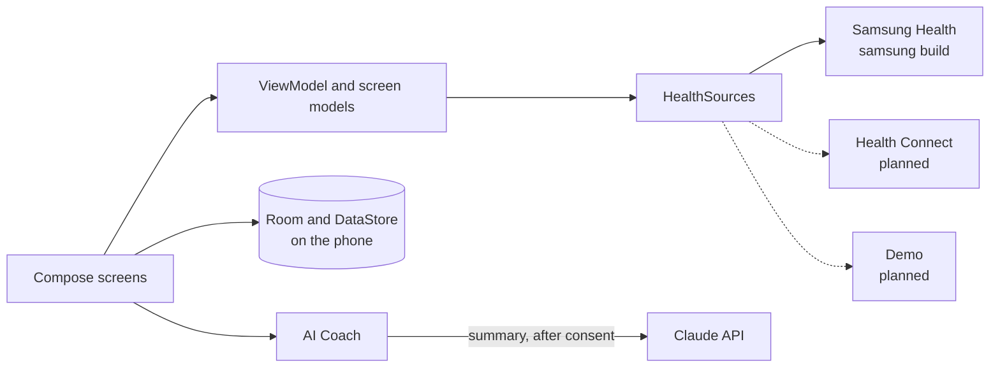

<p align="center">
  
</p>

<h1 align="center">ArjunFit</h1>

<p align="center">
  <b>Your fitness. Your device. Your AI coach.</b><br>
  An Android fitness app in Kotlin and Jetpack Compose, by Arjun Vision Tech Solutions.
</p>

<p align="center">
  <a href="https://github.com/arjunvision/arjun-fit-ai/actions/workflows/android-ci.yml"></a>
</p>

ArjunFit brings your wearable's health data, your workouts, food and weight, and a Claude-powered AI
coach into one private app. Health data is read-only and stays on your phone.

**Status:** in development, version **0.9.0-alpha2**. Private repository. See the [roadmap](#roadmap).

## Features

**Working today**

- **Health data from Samsung Health** (read-only): steps, heart rate, sleep with stages, blood oxygen,
  weight and body composition, exercise, activity summary, food and water. Tested with a Galaxy Fit3.
- **Dashboard** with daily goals, and detail screens for steps, heart rate, sleep and blood oxygen.
- **Nutrition and weight**: log meals, water and weigh-ins in the app.
- **Gym workouts**: plans, an 876-exercise library with photos, live sets and a rest timer that
  vibrates on your band.
- **Progress**: the Winter Arc timeline, weight trend, activity and workouts.
- **AI Coach** on Claude: asks first, sends only a short daily summary, uses your own API key.
- Respects the system "remove animations" setting.

**Planned** (not built yet): Health Connect for Fitbit, Pixel Watch, Garmin, Amazfit, Xiaomi and phone
step counting · Demo mode · GPS recording for walks, runs and rides · personal records · weekly AI
reports · challenges and badges · community features.

## Design

[](docs/design/arjunfit-screens.jpg)

Design concept with sample numbers; the app itself shows only your real data. The editable version is
the [ArjunFit design canvas](https://claude.ai/artifact/KQCt47XnQcCAeKeRZuY2tx). App screenshots will
be added from Demo mode, never from real health data.

## Architecture



Every data source implements one `HealthDataSource` interface and returns the same models, so screens
never depend on a vendor SDK. Details: [system architecture](docs/architecture/SYSTEM_ARCHITECTURE.md).

## Getting started

Requirements: [Android Studio](https://developer.android.com/studio) and an Android 10+ phone or
emulator.

### Option A: the `open` build (no extra downloads)

```bash
./gradlew assembleOpenDebug
```

Or choose **`openDebug`** in Android Studio's Build Variants panel. This build leaves out the Samsung
Health SDK. (Until Health Connect and Demo mode arrive in the next stage, it has no health data
source.)

### Option B: the `samsung` build (reads Samsung Health)

> **The Samsung Health Data SDK is not in this repository.** Its licence doesn't allow
> redistribution; `app/libs/*.aar` is git-ignored and each developer downloads it from Samsung.

1. Download the Samsung Health Data SDK (tested with v1.1.0) from
   https://developer.samsung.com/health/data/process.html (Samsung account sign-in).
2. Copy `libs/samsung-health-data-api-1.1.0.aar` into `app/libs/`. Any `samsung-health-data-api*.aar`
   is picked up; the build stops with a clear message if none is there.
3. Build `samsungDebug` and run on a real phone (the SDK doesn't support emulators).

On the phone:

- Samsung Health 6.30.2 or later, opened once with its setup and terms completed.
- Developer mode (needed until ArjunFit is a registered Samsung Health partner): Samsung Health › ⋮ ›
  Settings › About Samsung Health › tap the version line 10+ times › Developer mode (Samsung Health
  Data SDK) › agree › turn on **Developer Mode for Data Read**.
- Sync your band in Samsung Health first; its data reaches ArjunFit through the Samsung Health app.

### AI Coach

Open **Coach**, agree to share the daily summary, and paste your own Claude API key from
[console.anthropic.com](https://console.anthropic.com). The key is encrypted on the phone and never
built into the app. Model: Claude Opus 5.5 at low effort.

## Privacy and permissions

- Health access is **read-only**; ArjunFit never asks for write permission.
- Your logs, workouts and chat stay in databases on the phone; cloud backup is off.
- Nothing goes to the AI Coach until you agree, and then only a short summary (no name, no raw records).
- No ads, analytics or tracking.

More: [privacy design](docs/PRIVACY.md) · [security policy](docs/SECURITY.md).

## Testing

```bash
./gradlew testOpenDebugUnitTest lintOpenDebug
```

GitHub Actions runs the build, lint, unit tests and a Gitleaks secret scan on every push and pull
request. The real-phone checklist is in [docs/TESTING.md](docs/TESTING.md).

## Roadmap

| Version | Milestone | Status |
|---|---|---|
| 0.8.x | Samsung Health app with workouts, nutrition, progress and AI Coach | Done |
| 0.9.0 | Universal health data: Health Connect and Demo mode | In progress |
| 0.10.0 | GPS activity recording ([design](docs/GPS_TRACKING.md)) | Planned |
| 0.11.0 | Activity analytics and personal records | Planned |
| 0.12.0 | Advanced AI Coach: weekly reports, plans, recovery | Planned |
| 0.13.0 | Challenges and achievements | Planned |
| 0.14.0 – 0.15.0 | Community, clubs and leaderboards | Planned |
| 1.0.0 | Public release candidate | Planned |

Planned milestones, not promises. Changes so far: [CHANGELOG.md](CHANGELOG.md).

## Contributing

See [CONTRIBUTING.md](CONTRIBUTING.md). Security issues: [docs/SECURITY.md](docs/SECURITY.md).

## Toolchain

AGP 8.13.1 · Gradle 9.2.1 · Kotlin 2.2.21 · Compose BOM 2025.10.01 · Java 17 target · minSdk 29
(Android 10) · targetSdk/compileSdk 36. `applicationId`: `com.arjunvision.arjunfitai`.

## Credits

- Fonts: [Poppins](https://fonts.google.com/specimen/Poppins) (SIL Open Font License) and
  [Satisfy](https://fonts.google.com/specimen/Satisfy) (Apache 2.0).
- Exercises and photos: [free-exercise-db](https://github.com/yuhonas/free-exercise-db) (Unlicense).
- Licence texts ship in the app under `assets/licenses/`.

## Licence

No licence has been chosen yet; all rights reserved by Arjun Vision Tech Solutions until one is.
