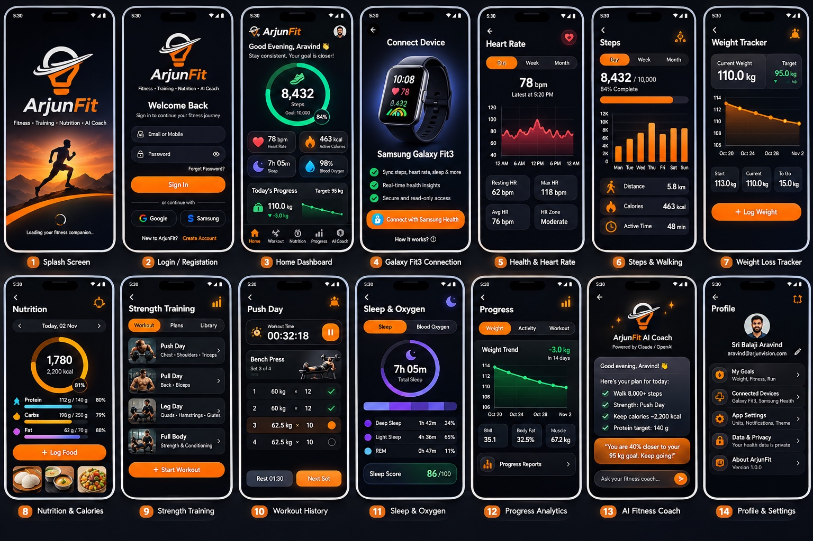

  

# ArjunFit

Kotlin + Jetpack Compose app that reads Samsung Health data (READ-only) through the
Samsung Health Data SDK.

## Design

Design concept with sample numbers; the app itself shows only your real data. Click the image for
full size (GitHub's download button saves it). The editable version is the
[ArjunFit design canvas](https://claude.ai/artifact/KQCt47XnQcCAeKeRZuY2tx).

## Setup

> **The Samsung Health Data SDK is not in this repository.** `app/libs/*.aar` is git-ignored;
> each developer downloads the SDK from Samsung under Samsung's own terms.

1. Download the Samsung Health Data SDK (tested with v1.1.0) from
   https://developer.samsung.com/health/data/process.html (Samsung account sign-in).
2. Unzip it and copy `libs/samsung-health-data-api-1.1.0.aar` into `app/libs/`. Any file named
   `samsung-health-data-api*.aar` is picked up; the build stops with a clear message if none is there.
3. Open the project in Android Studio and run on a real phone (the SDK does not support emulators).

No Samsung SDK? Build the `open` variant instead: `./gradlew assembleOpenDebug` (or pick
`openDebug` in Android Studio's Build Variants panel). It leaves Samsung Health out entirely.

## Samsung Health on the test phone

- Samsung Health 6.30.2 or later, opened once with its setup and terms completed.
- Developer mode (needed until the app is registered as a Samsung Health partner):
  Samsung Health › ⋮ › Settings › About Samsung Health › tap the version line 10+ times ›
  Developer mode (Samsung Health Data SDK) › agree › turn on **Developer Mode for Data Read**.
- Galaxy Fit3 data reaches the SDK through the Samsung Health app, so sync the band first.

## Code layout

| Path | Role |
| --- | --- |
| `data/samsung/SamsungHealthRepository.kt` | Connect, check/request READ permissions, read each data type |
| `data/samsung/HealthMetric.kt` | The seven data types read and their READ permissions |
| `data/samsung/SamsungHealthError.kt` | Maps SDK errors to app reasons and Samsung Health's `resolve()` fix-up |
| `data/samsung/model/` | SDK-free models used by the UI |
| `ui/dashboard/` | ViewModel and Compose dashboard |

Data read: steps (today), activity summary (today: active/total calories, active time, distance),
heart rate (7 days), sleep (7 days), blood oxygen (7 days), exercise (30 days), weight/body
composition (90 days). The app never requests WRITE permissions.

## Toolchain

AGP 8.13.1, Gradle 9.2.1, Kotlin 2.2.21, Compose BOM 2025.10.01, Java 17 target,
minSdk 29, targetSdk/compileSdk 36. `applicationId` is `com.arjunvision.arjunfitai`; register
that package name and your signing SHA-256 with Samsung when you apply for partnership.
