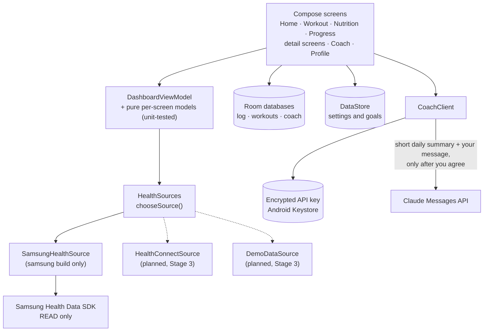

# ArjunFit system architecture

Status: describes **v0.9.0-alpha2**. Parts marked *planned* are not built yet.

## Big picture

ArjunFit is one Android app module (`app/`) written in Kotlin with Jetpack Compose. Health data is
read on the phone and stays on the phone. The only network traffic is the AI Coach, and only when you
send it a message.

## Health data sources

| Piece | File | Role |
|---|---|---|
| `HealthDataSource` | `data/health/HealthDataSource.kt` | The one interface every source implements: availability, connect, permissions, and every read |
| Shared models | `data/health/model/HealthModels.kt` | Steps, heart rate, sleep with stages, SpO2, weight, exercise, activity summary, food, water. No SDK types |
| `HealthMetric`, `PermissionStatus` | `data/health/HealthMetric.kt` | What can be read, and what the user allowed |
| `chooseSource()` | `data/health/SourceSelection.kt` | Pure rules for which source to use (see below) |
| `HealthSources` | `data/health/HealthSources.kt` | Holds the sources in this build and the current one |
| `HealthDataError` | `data/health/HealthDataError.kt` | Failures the UI can explain, with the source's own fix where it has one |
| `SamsungHealthSource` | `app/src/samsung/.../data/samsung/` | Samsung Health Data SDK reads (samsung build only) |

**Choosing a source** (`chooseSource`):

1. A source picked in Settings is always kept. If it lacks permission, the app asks again; it never
   switches by itself.
2. Automatic: Samsung Health if it is installed and allowed, otherwise Health Connect if installed and
   allowed, otherwise the first installed one, to ask for permission.
3. Demo mode is never picked automatically, so sample data can't be mistaken for yours.

## Two builds

| Build | Samsung SDK | Who uses it |
|---|---|---|
| `samsung` (default) | Included. Needs the AAR in `app/libs/`, which is never committed | The maintainer's test phone |
| `open` | Not included | Everyone else, GitHub Actions, the future public repository |

The Samsung SDK's licence forbids redistributing it, so code that touches it lives only in
`app/src/samsung/`. The `open` build gets a stub factory from `app/src/open/` that returns no Samsung
source. Both builds share the same `applicationId`.

## Storage on the phone

| Store | What's in it |
|---|---|
| `arjunfit-log.db` (Room) | Food, water and weight you log in the app |
| `arjunfit-workouts.db` (Room) | Workout plans, sessions and sets |
| `arjunfit-coach.db` (Room) | AI Coach chat history |
| DataStore preferences | Name, goals, coach consent, onboarding flag |
| SharedPreferences + Android Keystore | Your Claude API key, encrypted with AES-GCM |

Database schemas are exported to `app/schemas/` (Room Gradle plugin) so every future schema change can
ship a tested migration instead of wiping data. `android:allowBackup="false"`: nothing is copied to
cloud backups.

## AI Coach

- Calls the Claude Messages API straight from the phone with **your own** API key (bring your own key).
- Sends only a short summary built by `coachSummary()` (steps, heart-rate range, sleep, weight trend,
  today's workout and food totals) plus the recent chat. No raw health records, no name.
- Nothing is sent until you agree on the consent screen. "What the coach sees" shows the exact text.
- The fixed instructions are prompt-cached. The coach gives general fitness guidance, not medical advice.
- Before the app is distributed to people who don't have their own key, the key must move to a small
  server-side proxy (planned, see the roadmap in `README.md`).

## Planned additions

- Health Connect and Demo sources: [`docs/HEALTH_CONNECT.md`](../HEALTH_CONNECT.md)
- GPS activity recording: [`docs/GPS_TRACKING.md`](../GPS_TRACKING.md)
